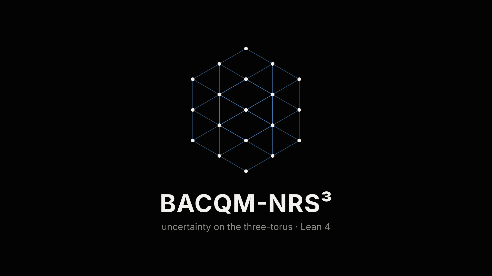

**[▶ naype888-cloud.github.io/BACQM-NRS3](https://naype888-cloud.github.io/BACQM-NRS3/)**

`R³`: every axis open. `T³`: every axis closed. Fibred box: `x`, `y`, `z` open, the fibre `w` closed with three positions. `T³ × w`: every axis closed, the fibre included. Lean 4, standard axioms.

| | R³ | T³ | Fibred box · T³ × w | Status |
|---|---|---|---|---|
| uncertainty relation / covariance determinant | Physlib [#1723](https://github.com/leanprover-community/physlib/pull/1723), [#1725](https://github.com/leanprover-community/physlib/pull/1725) | `Torus.robertson_det_torus`, `TorusStrict.robertson_det_torus_lt`, `Torus.det_covMatrix_maxState` (125/64) | `BoxStrict.robertson_det_box_lt` | Lean; position by position, continuity and Robertson for bits on all four: `SiteEventsTopologies.rate_openCube`, `SiteEventsTopologies.rate_torus`, `SiteEventsTopologies.rate_box`, `TorusFiberDirac.rate_torusFiber` |
| light share / dark share | `DarkShare.lightShare_maxCurrentState` | `TorusDark.lightShare_add_darkShare`, `TorusDark.lightShare_maxState` (4/5, 1/5) | `FiberDark.darkShare_pos_of_band`, `FiberDark.lightShare_fiberMaxState` | Lean |
| boundary entropy / area law | one wall, `dy·dz`: `OpenCubeBoundary.bekenstein_bound` | two walls, `2·dy·dz`: `TorusArea.cutEntropy_eq`, `TorusBekenstein.bekenstein_bound` | `FiberBoundary.entropy_le_x`, `FiberBoundary.entropy_le_w` | Lean |
| saturation / uniform field | `OpenCubeBoundary.saturated_iff_uniform` | `TorusSaturation.saturated_iff_uniform`, `TorusDarkFoam.meanField_uniform` | `FiberBoundary.saturated_iff_uniform_w` | Lean; the boundary bits commute on every cut (`EventsTopology.openEvent_comm`); full ⇒ dark declared (`TorusSaturation.HSaturationDark`) |
| Bakry–Émery curvature / Ricci lower bound | flat, `CD(0, 2)`: `BakryEmery.path_CD02` | flat (sides ≥ 5): `TorusBochner.not_curvature_pos` | `K = 4` (16-cell): `BochnerCurvature.cell16_curvature` | Lean |
| Lorentz cone / admissible cone | `UncertaintyCone.mem_futureCone` | `TorusCone.axisVector_mem_futureCone`, `TorusCone.timelike_of_band` | `BoxCone.axisVector_mem_futureCone` | Lean |
| Dirac operator / doubler modes | `OpenDirac.dirac_sq` | even sizes, eight doublers: `TorusDirac3.dirac3_sq`, `TorusDirac3.dirac3_wave`; one axis of mass `m` moves at most at `√(1 + m²) − \|m\|`: `TorusUniverse.abs_velocity_le_of_dirac` | `FiberDirac.dirac_sq`, `FiberDirac.fiberMass_sq`; gap `\|E\| ≥ ½`: `FiberDirac.abs_energy_ge`, `TorusFiberDirac.abs_energy_ge`; on `T³ × w`, `D₄² = T_x² + T_y² + T_z² + T°_w²` and speed `≤ 1/φ` on each axis: `TorusFiberDirac.dirac_sq`, `TorusFiberDirac.abs_velocity_le_inv_goldenRatio_axes` | Lean |
| Einstein / Unruh flow | `CutEinstein.clausius_openCube` | `CutEinstein.clausius_torus` | `CutEinstein.clausius_fiber` | Lean, conditional on Clausius per light sheet and Bianchi (`CutEinstein.einstein_cut`) |
| boundary light below capacity / layered boundaries | `TorusWhiteBall.openCube_exists`, `TorusStack.dark_openCube` | `TorusWhiteBall.torus_exists`, `TorusLayers.card_interiors_torus`, `TorusLayers.face_dark_torus`, `TorusStack.dark_torus` | `TorusWhiteBall.fiberX_exists`, `TorusWhiteBall.fiberW_exists`, `TorusStack.dark_fiberX`, `TorusStack.dark_fiberW` | Lean; `HWhiteBall`, `HCoreCollapse`, `HStack` declared |

Lean sources: [nrs3-tritoro](https://github.com/naype888-cloud/nrs3-tritoro) · [nrs3-hopf](https://github.com/naype888-cloud/nrs3-hopf) · [nrs3-dark](https://github.com/naype888-cloud/nrs3-dark) · [nrs3-uncertainty-cone](https://github.com/naype888-cloud/nrs3-uncertainty-cone) · [nava-robertson-schrodinger](https://github.com/naype888-cloud/nava-robertson-schrodinger)
